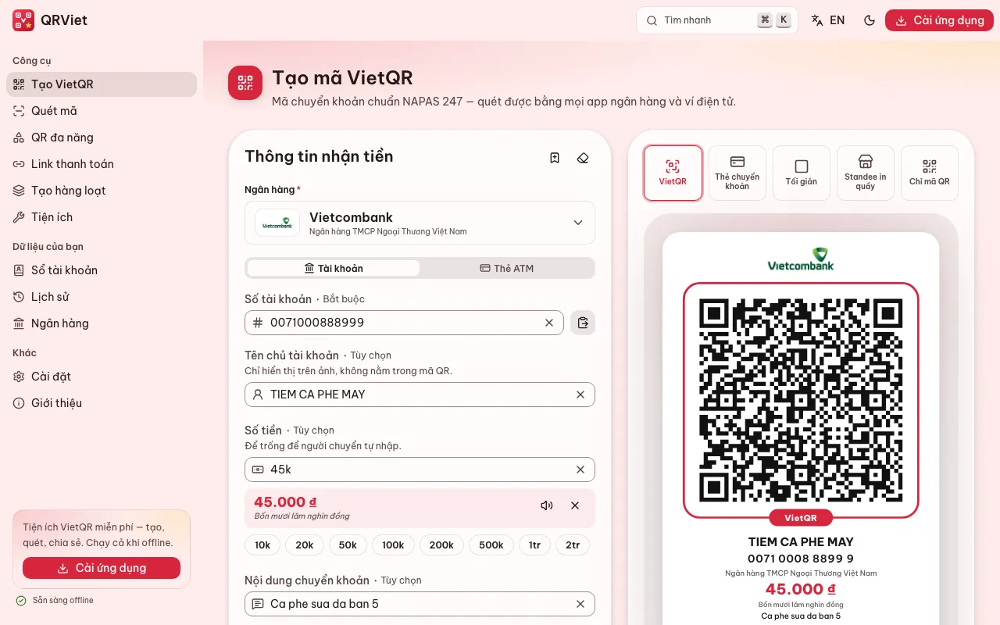
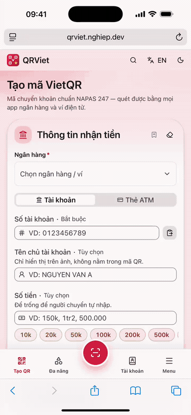

# QRViet

[](LICENSE)
[](https://nodejs.org/)
[](https://pnpm.io/)
[](CONTRIBUTING.md)

Create, scan and share **VietQR** bank-transfer codes — and launch **40+ Vietnamese banking & e-wallet apps via offline Deeplinks** — for every Vietnamese bank and e-wallet.

QRViet is a static single-page app: there is no server, it installs as a PWA, it works offline and your data never leaves your device. The interface is in Vietnamese by default, with a complete English translation.

<table>
  <tr>
    <td width="77%" align="center" valign="middle">
      
    </td>
    <td width="23%" align="center" valign="middle">
      
    </td>
  </tr>
</table>

## Contents

- [Features](#features)
- [Getting started](#getting-started)
- [Configuration](#configuration)
- [Deployment](#deployment)
- [Architecture](#architecture)
- [SEO](#seo)
- [Privacy](#privacy)
- [Contributing](#contributing)
- [Security](#security)
- [Acknowledgements](#acknowledgements)
- [License](#license)
- [Disclaimer](#disclaimer)

## Features

### Create

- **VietQR codes**: NAPAS 247 (EMVCo) payloads for accounts and cards, static or dynamic, with amount, message, bill number (tag 62.01), reference label (62.05) and merchant name and city (59 and 60).
- **Smart input**: a bank picker with logos, accent-insensitive search (`a chau` finds ACB), favourites and recents; amounts such as `150k`, `1tr2` or `2 triệu 300k`; the amount in words in Vietnamese or English, read aloud on request; automatic accent stripping with a counter for the 25-character NAPAS message limit; pasting the account number from the clipboard.
- **Image templates**: VietQR (frame and bank logo), transfer card, minimal, counter standee (A-series ratio) and QR only, with an accent colour, a title, a masked account number and optional branding.
- **Code design**: 8 dot styles, 5 eye frames and 5 eye balls, linear or radial gradients, a separate eye colour, a transparent background, a centre logo (the bank's, QRViet's or your own image), the error-correction level and the margin. Error correction is raised automatically under a logo, and low contrast is flagged.
- **Scan self-check**: every style change re-renders the code and decodes it back (BarcodeDetector or jsQR) to confirm that it still scans.
- **Export and share**: PNG download, copy as an image, Web Share (straight into Zalo, Messenger and other apps), and A5 printing.

### Scan

- **Inputs**: the camera (BarcodeDetector with a jsQR fallback) with torch, camera switching and continuous scanning; image files, pasted screenshots and drag and drop; pasted text; content shared from other apps (Web Share Target).
- **Results**: the bank, the amount in words, the CRC check and the full EMV field table, with actions to launch your banking app via **Deeplink**, edit and recreate the code, or save the account.
- **Other QR content**: links, Wi-Fi networks, vCard and MeCard contacts, email, SMS, phone numbers, locations and calendar events.

### Share and automate

- **Payment links**: a payment page whose data lives in the URL `#` fragment, which browsers never send to a server. It has copy buttons for every field, an offline **Deeplink** launcher for banking apps, a step-by-step guide, an expiry countdown, a note and the amount in words (read aloud on request), plus a printable QR code that opens the link. On request, a link also shows the payee and amount in its preview on Zalo or Facebook (see [Privacy](#privacy)).
- **Offline banking app Deeplinks**: launch 41 Vietnamese banking and e-wallet apps directly from `/pay` or `/scan` with zero network calls or intermediary servers. Classifies capability honestly per app (`Deeplink · Auto-fill` for verified MB Bank & MoMo P2P on iOS, `Deeplink · QR Pay` for unsigned VietQR handoff on iOS, and `Deeplink` quick-launch with automatic account clipboard copy on others/Android), warns inside In-App Browsers (Zalo, Messenger, Facebook, Instagram, TikTok, LINE), remembers the payer's preferred app, and monitors focus/visibility to offer App Store / Play Store or QR-save fallbacks.
- **Batch**: paste rows from Excel or CSV (tab, `;` or `,` is detected automatically) or generate sequences (Room 101 to 120); every row is validated; download a ZIP file (PNG images plus a CSV of every row) or A4 label sheets (2×3, 3×4 or 4×5).
- **QR studio**: links, text, Wi-Fi, vCard contacts, social profiles (Zalo, Facebook, TikTok and more), email, SMS, phone calls, locations and events, with a caption under the code and an HTML embed snippet.

### Your data and tools

- **Account book**: card colours, a default account, JSON import and export, and undo for deletions.
- **History**: search, filters, pinning and reopening past codes, each shown as the image that was exported.
- **Bank directory**: 76 banks and e-wallets with BIN, short code, SWIFT code, NAPAS 247 support, and **Deeplink** capability tags and filters.
- **Utilities**: a VietQR string checker with CRC repair, amount in words, transfer-message cleanup, bill splitting and a CRC16 calculator.

### App

- **Brand and themes**: its own logo and icon set (three QR finder squares, a "V" and a gold star); 6 QRViet themes and 7 Astryx themes; a theme builder (accent, neutral tone, high contrast, radius, type scale, live preview, JSON import and export); light, dark or system mode; 4 font choices with full Vietnamese support.
- **Installable PWA**: installation on Android and desktop, plus an in-app Safari "Add to Home Screen" walkthrough modal for iOS (`public/guides/safari-install.mp4`), app shortcuts, a share target and an update prompt. Every asset, bank logos and fonts included, is precached for offline use. On iOS, launch screens cover every iPhone and iPad size in light and dark, and the layout keeps clear of the notch, status bar and home indicator.
- **Keyboard and touch**: a command palette (`Ctrl`/`⌘` + `K`), `Shift` + `D` to toggle light and dark, `Shift` + `S` to open the scanner, an app-style bottom tab bar on phones, and a loader that respects reduced motion.
- **Link previews and SEO**: one preview card for the whole site and a payment card for payment links (with the payee and amount, for links that ask for it), a localized title for every page, and personal pages kept out of search (see [SEO](#seo)).

## Getting started

### Prerequisites

- [Node.js](https://nodejs.org/) 26
- [pnpm](https://pnpm.io/installation) 12

Both versions are enforced: installing with another version or another package manager stops with an error.

### Run locally

```bash
pnpm install
pnpm dev
```

Then open <http://localhost:3000>.

### Scripts

| Command | Description |
| --- | --- |
| `pnpm dev` | Start the development server on port 3000. |
| `pnpm build` | Type-check, then build the static site into `dist/client/` with the service worker. |
| `pnpm preview` | Serve the production build on port 4173, service worker and offline mode included. |
| `pnpm typecheck` | Type-check the project without building it. |
| `pnpm gen:splash` | Re-render the iOS launch screens after a change to the boot splash in `src/app/boot-splash.ts`. Needs Chrome; shrinks the images with ffmpeg when it is installed. |
| `pnpm sync:banks` | Refresh `src/data/banks.json`, `public/banks/` logos, and `src/data/bank-apps.json` by crawling VietQR APIs, `dl.vietqr.io`, and `vietqr-core`. Needs network access; converts logos to WebP with cwebp when installed (supports `--no-logos`, `--deeplinks-only`, `--no-deeplinks`). |

Node.js runs the TypeScript in `scripts/` directly (type stripping), so the scripts need no build step.

## Configuration

The app has no runtime configuration. These environment variables are read at build time:

| Variable | Default | Description |
| --- | --- | --- |
| `BASE_PATH` | `/` | Public base path when the app is not served from the root of its domain, for example `/qrviet/`. Starts and ends with `/`. |
| `SITE_URL` | Detected on Netlify and Vercel | Public URL of the deployment, as an origin or a full URL. Link previews need it for the absolute URL of their image; the base path is appended when it is missing. |
| `CHROME_PATH` | Detected | Chrome or Chromium binary for `pnpm gen:splash`. |

## Deployment

`dist/client/` is a static site; publish that folder. (`dist/server/` only renders the HTML during the build and is not deployed.) It has two HTML files: `_shell.html`, the app shell that every page is served with, and `pay.html`, the same shell with the preview card for payment links.

- **Netlify**: nothing to configure. `public/_redirects` serves the app shell for every path that is not a file, Netlify provides `SITE_URL`, and it runs the edge function for detailed payment link previews (see [SEO](#seo)).
- **Other static hosts**: serve existing files first, `pay.html` at `/pay`, and `_shell.html` with status 200 for every other path. With Nginx: `try_files $uri $uri.html /_shell.html;`. Set `SITE_URL` when you build, so that link previews get an absolute image URL. Payment links that ask for a detailed preview work there too, with the general payment card.

The camera and the service worker need HTTPS, or `localhost` during development.

> [!NOTE]
> iOS reads the launch screen (`apple-touch-startup-image`) only when the app is added to the Home Screen, and keeps the light or dark variant that matched at that moment. Remove the app and add it again to see a changed launch screen.

## Architecture

QRViet is a client-only React app with no backend (on Netlify, one optional edge function fills in detailed payment link previews):

- **Build**: [Vite](https://vite.dev/) with the [React Compiler](https://react.dev/learn/react-compiler), which memoizes components and hooks automatically, so the code has no `useMemo`, `useCallback` or `memo`. It runs as the compiler's Rust port (`oxc-transform-react`, enabled with `react({compiler})` in `@vitejs/plugin-react`), without Babel. A component that breaks the Rules of React is left uncompiled: it still works, without automatic memoization.
- **UI**: [Astryx](https://github.com/meta/astryx), Meta's design system for React 19 with prebuilt StyleX: app shell, navigation, command palette, dialogs and bottom sheets, toasts, runtime themes for the theme builder and `vi-VN` translations. [Tailwind CSS](https://tailwindcss.com/) v4 handles layout through the Astryx token bridge.
- **Framework, routing and state**: [TanStack Start](https://tanstack.com/start) in SPA mode: the app renders in the browser, and the build writes the app shell that every page is served with, plus a copy for `/pay` with its own preview card. Underneath, [TanStack Router](https://tanstack.com/router) (file-based routes, automatic code splitting, validated search params, document head management) and [TanStack Store](https://tanstack.com/store) (state persisted to `localStorage` and synced across tabs).
- **QR codes**: [uqr](https://github.com/unjs/uqr) encodes them and a custom renderer draws them to SVG and Canvas. Scanning uses `BarcodeDetector`, with a lazy-loaded [jsQR](https://github.com/cozmo/jsQR) fallback.
- **Offline**: [Serwist](https://serwist.pages.dev/) builds the TypeScript service worker in `src/sw.ts` with the precache list injected, and `@serwist/window` registers it and drives the "new version" prompt. The worker serves the precached app shell for every navigation, and `pay.html` for `/pay`. TanStack Start builds the client and the server with shared plugins, which `@serwist/vite` does not handle on its own, so a short wrapper in `vite.config.ts` runs its build for the client output, once Start has written the HTML pages. The web app manifest is a static file, `public/manifest.webmanifest`.

### Project structure

```text
src/
  app/                 # providers, navigation, PWA and keyboard helpers, boot splash, iOS launch screens
  components/          # UI by area: bank, brand, common, layout, pay, qr, scan, settings, vietqr
  data/banks.json      # offline bank directory (pnpm sync:banks)
  data/bank-apps.json  # offline banking & e-wallet app Deeplink specs (pnpm sync:banks)
  data/bank-apps.ts    # typed Deeplink registry loader & App/Play Store URL helpers
  hooks/               # shared React hooks
  i18n/                # vi.ts (source of truth) and en.ts (type-checked for missing keys)
  lib/                 # plain TypeScript without React
    emv.ts             #   TLV and CRC16-CCITT
    vietqr.ts          #   build, parse and validate VietQR (NAPAS) payloads
    money.ts, text.ts  #   VND amounts ("1tr2"), amounts in words, accent stripping
    payloads.ts        #   Wi-Fi, vCard and other payloads; classifying scanned content
    qr/                #   styled QR geometry, scene graph (SVG and Canvas), templates, export
    deeplink.ts        #   offline banking app Deeplink plans, OS & IAB detection
    scan.ts, zip.ts, paylink.ts, persist.ts
  routes/              # file routes, one per page
    __root.tsx         #   the HTML document (head, boot splash) around the app
    $.tsx              #   unknown URLs
  seo/head.ts          # route heads: page titles and the link preview cards
  seo/pay-preview.ts   # a payment link's detailed preview, shared with the edge function
  stores/              # TanStack Store: settings, accounts, history, studio
  theme/               # theme presets, theme builder (Astryx defineTheme), fonts
  router.tsx           # router setup (TanStack Start's entry point)
  routeTree.gen.ts     # generated by TanStack Start, do not edit
  sw.ts                # service worker (Serwist)
netlify/edge-functions/
  pay-preview.ts       # Netlify only: writes a detailed preview into pay.html
public/
  _redirects           # Netlify: the app shell for every page
  banks/               # bank logos (WebP, precached)
  guides/              # iOS Safari Add to Home Screen guide (MP4 for the app, GIF for this README)
  screenshots/         # screenshots for the web app manifest and this README
  splash/              # iOS launch screens (pnpm gen:splash, not precached)
  manifest.webmanifest # web app manifest
scripts/
  generate-splash.ts   # renders public/splash/ from the boot splash
  sync-banks.ts        # refreshes the bank list and logos (run on demand)
vite.config.ts         # TanStack Start (SPA mode) and the service worker
```

## SEO

The app renders in the browser, and every page is served the same HTML, the app shell:

- **Link previews**: Facebook, Zalo and other apps that do not run JavaScript show one card for the whole site, with the home page's title and description and `og-image.png`. Payment links get a card of their own from `pay.html`, with `og-image-pay.png`. It cannot show the payment itself: the details stay after the `#`, which never reaches a server or a link preview.
- **Detailed payment previews**: a link made with **Show name and amount in link previews** on carries its bank, name and amount in the query string instead (see [Privacy](#privacy)). On Netlify, the edge function in `netlify/edge-functions/pay-preview.ts` writes them into the title and description of `pay.html`, for example "Chuyển 50.000 ₫ cho NGUYEN VAN A". Links without them, and requests it fails on, get `pay.html` as it is.
- **Search engines**: Google runs the app and sees each page's own title. `/history`, `/settings`, `/pay` and unknown URLs are `noindex`.
- **Where to edit**: the tags are built in `src/seo/head.ts`, the detailed payment preview in `src/seo/pay-preview.ts`, and the titles and descriptions are the `seo.*` keys in `src/i18n/vi.ts` and `src/i18n/en.ts`.

## Privacy

All data stays in the browser: the account book, history and settings in `localStorage`, and the small history previews of exported images in IndexedDB. Payment links carry their data in the `#` fragment, which browsers never send to the server. The one exception is opt-in: with **Show name and amount in link previews** on, a link carries the bank, name and amount in its query string, so that the host can put them in the link preview; the account number and message stay in the fragment. You can back up, restore or erase everything under **Settings → Data**; backups leave the previews out.

## Contributing

Contributions are welcome, from bug reports and translations to new features. The [contributing guide](CONTRIBUTING.md) explains how to set up the project, the conventions it follows and how to open a pull request. Everyone taking part is expected to follow the [Code of Conduct](CODE_OF_CONDUCT.md).

## Security

Please do not report security problems in public issues. The [security policy](SECURITY.md) explains how to report them privately.

## Acknowledgements

- [Astryx](https://github.com/meta/astryx), [TanStack](https://tanstack.com/), [Serwist](https://serwist.pages.dev/), [uqr](https://github.com/unjs/uqr), [jsQR](https://github.com/cozmo/jsQR) and [Lucide](https://lucide.dev/) icons.
- The [Be Vietnam Pro](https://fonts.google.com/specimen/Be+Vietnam+Pro), [Inter](https://rsms.me/inter/) and [Nunito](https://fonts.google.com/specimen/Nunito) typefaces, packaged by [Fontsource](https://fontsource.org/).
- The bank list, logos and deeplink catalogs from the public VietQR APIs (`api.vietqr.io` & `dl.vietqr.io`), alongside banking app Deeplink references from [Ngochiendev/vietqr-core](https://github.com/Ngochiendev/vietqr-core).

## License

The source code is released under the [MIT License](LICENSE).

Bank names and logos (`public/banks/` and `src/data/banks.json`) are trademarks of their respective owners and are not covered by this license. The bundled fonts are licensed under the SIL Open Font License 1.1.

## Disclaimer

QRViet is an independent project and is not affiliated with NAPAS, VietQR or any bank. Always check the recipient's name in your banking app before you confirm a transfer.
